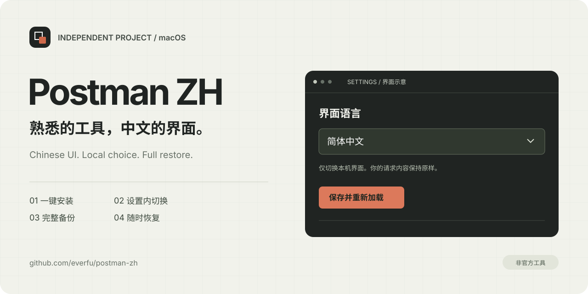
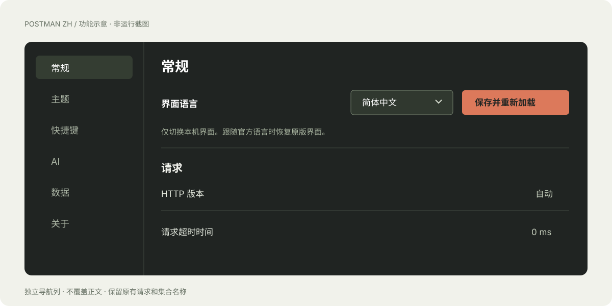

<p align="center"></p>
<h1 align="center">Postman ZH</h1>
<p align="center">A Chinese interface for Postman on macOS, with a local language switch and a complete restore path.</p>
<p align="center">
  <a href="https://github.com/everfu/postman-zh/releases/latest"></a>
  <a href="https://github.com/everfu/postman-zh/actions/workflows/ci.yml"></a>
  
  <a href="./LICENSE"></a>
</p>
<p align="center"><a href="./README.md">简体中文</a> · English</p>



## Features

- Double-click to detect Postman, quit gracefully, back up the full application, and install the patch.
- Choose Simplified Chinese or the official Postman language from app settings. The choice persists across restarts.
- Restore the complete original application, including its vendor signature. Restoration does not depend on translation files.
- Keep request URLs, payloads, collection names, and account language untouched.
- Bundled translations; installation does not download executable code or request online translation. A compatible Postman build can provide the Node runtime.
- Public source, automated checks, downloadable releases, and SHA-256 checksums.

> **Unofficial local modification.** This project is not affiliated with or endorsed by Postman, Inc. Installation replaces the vendor signature with an ad-hoc signature and removes Hardened Runtime flags from the modified application. The original notarized identity is lost. System Gatekeeper, SIP, certificate validation, and Electron fuses are unchanged. Read the [signing and recovery notes](./docs/installation.md#应用签名与系统保护) before installation.

## Quick start

1. Download **`postman-zh-macos.zip`** from [Releases](https://github.com/everfu/postman-zh/releases/latest).
2. Extract the entire folder, save your work, and double-click **`postman-zh.command`**.
3. Press **`⌘ ,`** in Postman. Under **Interface language**, choose Simplified Chinese or **Follow Postman language**, then save and reload.

Following the official language restores the English or Japanese preference already set in Postman. The local switch does not change account or email language. Reload other open windows or restart the app when switching.

Terminal alternative:

```sh
bash ./postman-zh.command --install --quit --open
```

Restore by double-clicking `恢复原版.command` or running:

```sh
bash ./postman-zh.command --restore --quit --open
```

The script does not elevate privileges or disable system protections. See the [installation guide](./docs/installation.md) for permissions, custom paths, and recovery.

## Compatibility

| Environment | Evidence |
| --- | --- |
| macOS Apple Silicon / Postman 12.26.1 | Local and signed-in UI, settings layout, language switching, native menus, persistence, and full restoration tested |
| Postman 10.x / 11.x / other 12.x | Structure checks only; individual releases have not all been tested |
| Intel Mac | Not tested on hardware |
| Windows / Linux / web app | Not supported by this project |

The snapshot includes 183 translation modules and 5,032 local labels. Missing translations remain in the original language. Postman updates may overwrite the patch; reapply after updating. Automatic updates are not disabled.



The visual above is an original **illustration, not a runtime screenshot**. See the [compatibility notes](./docs/compatibility.md) for evidence boundaries.

## Commands

```sh
./postman-zh.command --check
./postman-zh.command --status
./postman-zh.command --version
./postman-zh.command --install --app "$HOME/Applications/Postman.app" --quit --open
```

## Development

Use Node.js **22.12+**. End users do not need development dependencies.

```sh
npm ci --ignore-scripts
npm run verify
npm run package
npm run test:package
```

Checks run on Linux and macOS. Release packaging requires macOS. CI does not install or modify a real Postman application.

[Architecture](./docs/architecture.md) · [Translation maintenance](./docs/translations.md) · [Contributing](./CONTRIBUTING.md) · [Security](./SECURITY.md) · [Media kit](./docs/media-kit.md) · [Changelog](./CHANGELOG.md)

## License and credits

Copyright © 2026 **everfu**. Original project code, documentation, and visual assets are available under [MIT](./LICENSE).

Translation snapshots come from [hlmd/postman-chinese-injector](https://github.com/hlmd/postman-chinese-injector). Upstream distinguishes its code license from derived translation data. The translations retain upstream notices and **are not relicensed under this project's MIT grant**. See [THIRD_PARTY_NOTICES.md](./THIRD_PARTY_NOTICES.md).

No Postman application, vendor source, original English language packs, or official brand assets are distributed.
