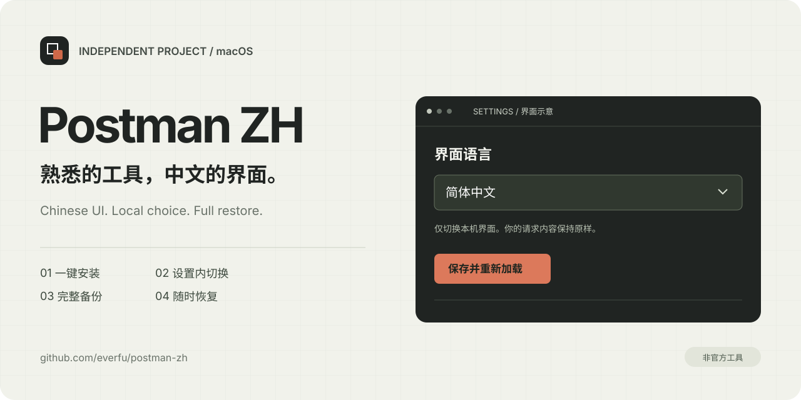
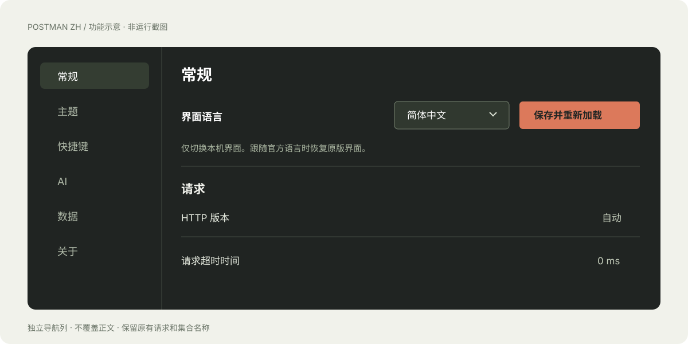

<p align="center"></p>
<h1 align="center">Postman ZH</h1>
<p align="center">熟悉的工具，中文的界面。为 macOS Postman 加入简体中文与设置内语言切换。</p>
<p align="center">
  <a href="https://github.com/everfu/postman-zh/releases/latest"></a>
  <a href="https://github.com/everfu/postman-zh/actions/workflows/ci.yml"></a>
  
  <a href="./LICENSE"></a>
</p>
<p align="center">
  <a href="https://github.com/everfu/postman-zh/releases/latest">下载</a> ·
  <a href="./docs/installation.md">使用指南</a> ·
  <a href="./docs/compatibility.md">兼容性</a> ·
  <a href="./CHANGELOG.md">更新记录</a> ·
  <a href="./CONTRIBUTING.md">参与贡献</a>
</p>
<p align="center">简体中文 · <a href="./README.en.md">English</a></p>



## 特性

- **一键安装**：双击脚本，自动探测 Postman、正常退出应用、备份并安装。
- **设置内切换**：选择“简体中文”或“跟随官方语言”，保存后重新加载；选择保留到下次启动。
- **完整恢复**：备份整份应用，恢复时同时还原原厂签名；翻译文件缺失也能执行恢复。
- **保留工作内容**：仅处理界面语言包与固定控件，不修改请求 URL、请求体、集合名称或账号语言。
- **安装不需联网下载**：翻译随版本包提供。通常可借用 Postman 的内置运行环境，无需另装 Node。
- **可检查的交付**：公开源码、自动检查、版本下载包和 SHA-256 校验文件。

> **非官方本地修改。** 与 Postman, Inc. 无关联、未获其背书。安装会重新签署本机应用，并移除该应用的 Hardened Runtime 签名标志；原厂签名与公证身份不再保留。系统 Gatekeeper、SIP、证书校验及 Electron fuses 不变。请先了解[签名影响与恢复方式](./docs/installation.md#应用签名与系统保护)。

## 快速开始

1. 到 [Releases](https://github.com/everfu/postman-zh/releases/latest) 下载 **`postman-zh-macos.zip`**，解压并保留整个文件夹。
2. 保存正在编辑的 Postman 内容，双击 **`postman-zh.command`**。
3. 安装完成后按 **`⌘ ,`** 打开设置，在右侧“界面语言”中选择语言并保存。

“跟随官方语言”使用 Postman 原本选择的 English 或日本語；本地中文开关不更改邮件与账号语言。其他已打开的窗口需要重新加载或重启应用。

如果 Finder 无法运行脚本，可在终端进入解压目录后执行：

```sh
bash ./postman-zh.command --install --quit --open
```

**恢复原版**：双击 `恢复原版.command`，或运行：

```sh
bash ./postman-zh.command --restore --quit --open
```

脚本不会自行提权或关闭系统保护。权限、启动限制、自定义安装路径等问题见[使用指南](./docs/installation.md)。

## 界面与兼容性



上图是项目原创功能示意，**不是运行截图**。实际验证环境和边界见[兼容性记录](./docs/compatibility.md)。

| 范围 | 状态 |
| --- | --- |
| macOS Apple Silicon / Postman 12.26.1 | 已实际验证本地与登录界面、语言往返切换、菜单、重启保存和整包恢复 |
| Postman 10.x / 11.x / 其他 12.x | 只做结构检测，尚未逐版本验证 |
| Intel Mac | 尚未实机验证 |
| Windows / Linux / 网页版 | 本项目不支持 |

提供 183 个模块的翻译快照和 5,032 条本地文案；覆盖不足的内容保留原文。Postman 自动更新后可能需要重新安装补丁。项目不承诺整个产品 100% 中文，也不会关闭自动更新。

## 常用命令

```sh
# 只读检查：应用结构、签名与原版备份
./postman-zh.command --check
./postman-zh.command --status

# 指定应用位置
./postman-zh.command --install --app "$HOME/Applications/Postman.app" --quit --open

# 工具版本
./postman-zh.command --version
```

完整参数、备份目录和中断恢复步骤见[安装与恢复指南](./docs/installation.md)。

## 开发

开发需要 Node.js **22.12+**。普通用户不需要安装开发依赖。

```sh
npm ci --ignore-scripts
npm run verify
npm run package
npm run test:package
```

`verify` 检查脚本、翻译数据、版本与文档链接，并运行行为测试。Linux 和 macOS 均可运行检查；生成发布包需要 macOS。CI 不安装或修改真实 Postman。

## 文档与素材

[安装与恢复](./docs/installation.md) · [兼容性与验证边界](./docs/compatibility.md) · [实现结构](./docs/architecture.md) · [翻译维护](./docs/translations.md) · [项目介绍与素材](./docs/media-kit.md)

欢迎提交可复现的问题与翻译改进，请阅读[贡献指南](./CONTRIBUTING.md)。涉及敏感信息的问题请使用[安全反馈渠道](./SECURITY.md)。

## 许可与致谢

Copyright © 2026 **everfu**。本项目原创代码、文档和视觉素材采用 [MIT](./LICENSE) 许可。

中文翻译快照来自 [hlmd/postman-chinese-injector](https://github.com/hlmd/postman-chinese-injector)，感谢上游贡献者。上游明确区分项目代码与派生译文；翻译数据保留原有声明，**不由本项目重新授予 MIT 许可**。来源、修改说明和许可边界见 [THIRD_PARTY_NOTICES.md](./THIRD_PARTY_NOTICES.md)。

本项目不分发 Postman 应用、原厂源码、原始英文语言包或官方商标素材。
