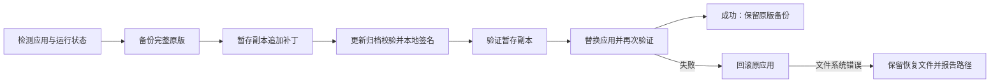

# 实现结构

运行时仅使用 Node/Electron 内置能力。`@electron/asar` 和 `jsdom` 是开发验证工具，不会作为依赖注入 Postman。

```text
postman-zh.command       Finder / 终端入口与运行环境探测
src/cli.cjs             检测、备份、暂存、签名、替换与恢复
src/asar.cjs            ASAR 头读取和追加式补丁
src/runtime/
  renderer.cjs          语言包响应、固定控件与设置开关
  main.cjs              macOS 原生菜单翻译与切换
  preferences.cjs       原子写入本机语言偏好
  chrome.cjs            项目维护的固定控件补译
locales/                上游翻译快照，保留单独声明
scripts/                检查、打包和发布包核验
test/                   行为测试与回归
docs/                   使用文档与原创素材
```

## 安装事务



仅在准备完毕后替换应用。原版备份包含整个 `.app` 及其签名，重装补丁从原版重新生成，避免叠加修改。恢复时验证版本、安装路径、归档摘要与备份签名。

ASAR 写入器保留原数据区和未修改文件的偏移，在末尾追加替换数据，并重写头与文件完整性记录。外部 unpacked 文件和链接不重新打包。测试使用官方 ASAR 工具交叉读取。

## 语言处理

1. Renderer preload 先于网页应用执行。
2. fetch/XHR 包装只匹配 Postman 官方域名下的 `/_ar-assets/locales/.../*.json`。
3. 中文模式合并已有的语言包键，未知模块、坏 JSON 和其他请求直接透传。
4. 本地轻量客户端使用固定文案词典；登录界面的新增静态控件使用更小的控件白名单。
5. 跳过请求与响应编辑器、代码、表格、用户树、文档内容和可编辑值。占位提示只改已识别的固定提示节点与属性。
6. 设置开关仅挂在明确识别的正文列；未知布局不做插入。

菜单翻译发生在 `Menu.buildFromTemplate` 构造之前，保留回调与原始模板。语言偏好改变后，主进程重建菜单；页面在用户点击保存后重新加载。

## 数据与边界

本机偏好仅保存 `{ "language": "zh-CN" }` 或 `{ "language": "en" }`。其中 `en` 表示关闭本地中文覆盖，跟随官方界面语言，不代表替用户修改官方账号语言。

安装清单放在应用资源目录，记录工具版本、原版备份位置、原始/补丁摘要与安装时间。清单及备份属于本机状态，不会写入仓库或发布包。

修改应用后必须重新签名。签名影响和中断恢复方法见[安装指南](./installation.md)，验证范围见[兼容性记录](./compatibility.md)。

参考：[Electron ASAR 完整性](https://www.electronjs.org/docs/latest/tutorial/asar-integrity)、[Postman 应用设置](https://learning.postman.com/docs/getting-started/installation/settings/settings-overview)。
